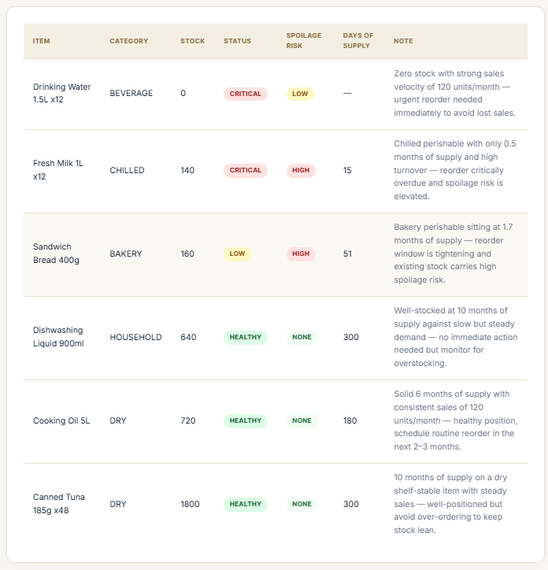
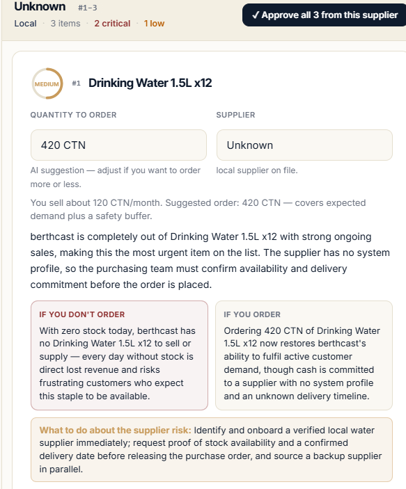

# berthcast

[](https://github.com/brother-yong/berthcast/actions/workflows/tests.yml)

Inventory analysis for food distributors. berthcast reads the inventory, sales,
supplier and purchase-order files a distributor already exports, flags what is
about to stock out and what was over-ordered, and writes the order to place,
grouped by supplier.

| At a glance | |
|---|---|
| **Status** | Live in production at [berthcast.com](https://berthcast.com) |
| **Pilot** | In use by a regional food distributor, on their real operations data |
| **Scale** | 1,300+ SKU catalogues; sales histories hundreds of thousands of rows deep |
| **Access** | No self-serve sign-up. Accounts and time-boxed trials are set up by the operator |
| **Testing** | 120 standalone test files, run in CI on every push |
| **Built by** | One person, end to end: product, code, design, and operations |

| Every SKU classified, with the reasoning attached | Recommendations with the stakes spelled out |
|---|---|
|  |  |

---

## What it does

Distributors live in spreadsheets that never line up: different column names,
free-text notes, mixed units, summary rows, multiple sheets, sales laid out as
one column per month. berthcast turns those into decisions.

### Core analysis

- **Reads** raw `.xlsx` / `.csv` exports without manual column mapping. It finds
  the header row, the real stock column, units and date formats. Wide sales
  sheets (one column per month) are handled by an AI-proposed layout that plain
  Python then converts and checks.
- **Shows what it read before it runs.** Staff confirm a readback of each file,
  and a quality gate scores every upload OK / WARN / BLOCK. A WARN shows the
  report with a plain caveat. A BLOCK stops the analysis and says what is wrong.
- **Merges duplicates.** The same product under different names is grouped, and
  staff review the groups before analysis. Grouped duplicates become one row per
  item; mixed pack units go to review instead of being added together.
- **Classifies** every item as `CRITICAL` / `LOW` / `HEALTHY` / `DEAD` /
  `REVIEW` from sales velocity, stock on hand and supplier lead time. Stock that
  runs out before a delivery could arrive is `CRITICAL`. Zero stock with no
  matching record goes to `REVIEW` instead of being guessed.
- **Recommends orders** with the stakes attached: revenue at risk, lead-time
  pressure, spoilage risk for chilled and frozen lines, and stock already on
  order. Order sizes subtract free stock, use lead times from the supplier
  sheet, and flag lines that are already covered or discontinued. Each line gets
  an order-by date in Singapore time.
- **Lets staff act.** Approve, edit or dismiss each recommendation, approve all
  (with undo), then print a purchase sheet or download a CSV. The inventory
  health report also prints and exports, in the sort staff choose.

### Around the analysis

- **Tenders.** Upload won contracts (customer, item, quantity, period). The
  contracted volume is added on top of order suggestions, and tender lines are
  paired to stock items automatically, with a page to correct the pairing.
- **Expiry.** Upload a lot-tracking export to see what has already expired and
  what expires in the next N days. Expiring lots appear on the results page, in
  the report email, and in a weekly digest.
- **Supplier directory.** Built from uploaded files, with duplicate supplier
  names suggested for merging. A merge is never applied without confirmation.
- **Run comparison.** Compare two analyses to see what changed between them.
- **Outcome tracking.** Staff record whether a warning came true, which builds
  the proof numbers for the pilot.
- **Chat assistant.** Answers questions about the latest analysis and about how
  to use the product.
- **Email alerts.** Analysis-ready and critical-stock emails, plus the expiry
  digest.
- **Sales links** (off by default, switched on per company). Joins a sales-sheet
  line to its stock items once, saves the link so repeat runs agree, and gives
  the operator a page to correct or undo links. Unsure matches are flagged on the
  order card and the printed sheet.

## How it works

The analysis is a small pipeline of focused agents, coordinated by an
orchestrator that owns the sequence and reports progress to the UI:

```
upload ──▶ readback + quality gate ──▶ duplicate review ──▶ inventory ──▶ recommendation ──▶ results
                                         (normalization)    (classify)    (decide + stakes)
                                                                 ▲
                                                             verifier
```

- **`agents/normalization.py`** finds the same product under different names.
- **`agents/inventory.py`** classifies stock health per item.
- **`agents/verifier.py`** is the deterministic safety net. It recomputes the
  classification rules in pure Python from the exact numbers the model saw and
  corrects provable slips before anything reaches the user.
- **`agents/recommendation.py`** turns classification into orders with
  consequences.
- **`agents/ingest_mapper.py`** proposes a layout for wide sales sheets from a
  small sample. It never sees the full file and never outputs quantities.
- **`agents/sales_links.py`** creates and applies saved sales links.
- **`agents/orchestrator.py`** runs the agents in order. It has no Flask, DB or
  email code and talks to the outside world through two callbacks.

Each uploaded dataset lands in its own per-session SQLite tables
(`inventory_<id>`, `sales_<id>`, …) so analyses never bleed into each other.

## Engineering highlights

The interesting problems here aren't the AI calls. They're everything around
them:

| The hard part | How berthcast handles it |
|---|---|
| Real exports are messy: drifting item names, summary rows, mixed date formats, month-per-column sales | Header-row detection, drift-tolerant name matching, total-row filtering, multi-format date parsing, and an AI-maps / Python-converts recipe for wide sheets that refuses rather than guesses. |
| AI output can't be blindly trusted with purchase decisions | Claude does the judgment, Python does the math. A deterministic verifier recomputes every status rule, and order quantities pass through a separate sanity check before they reach a printed sheet. |
| Bad data in means bad advice out | Upload readback, a quality gate (OK / WARN / BLOCK), and a report that states which data gaps make which numbers uncertain. |
| Failed or cut-off AI replies look like clean results | Every run gets a named real outcome (blank report, truncated reply, all recommendations errored). Bad outcomes alert the operator and never show as clean. |
| Repeated AI judgments can disagree | Sales links and tender pairings are saved once, and human corrections stick across runs. |
| Untrusted spreadsheet text reaches the prompt | Uploaded text is fenced as untrusted data, and lookalike fence tags are stripped until none are left. |
| Multiple companies' data on one box | Org-ownership checks on every data route, per-session tables, parameterised SQL, identifier whitelisting. |
| It has to stay up unattended | Daily backups with disk-space guards, a DB watchdog, stuck-analysis recovery, per-org API caps, per-call token and cost logging, and a post-deploy check that the live site runs the pushed commit. |

## Tech stack

| Layer | Choice | Why |
|---|---|---|
| Backend | Python 3.11 · Flask · Gunicorn (threaded) | Boring, stable, easy to reason about |
| AI | Anthropic Claude API (Sonnet 5.5 default; Haiku 5.5 for testing and the layout mapper) | Used for judgment only. All arithmetic is done, and re-checked, in Python |
| Data | SQLite, raw SQL, no ORM | Single-box app; per-session tables keep tenants apart with zero ops overhead |
| Frontend | Server-rendered Jinja + vanilla JS | No build step, no framework churn |
| Email | Gmail SMTP | Alerts, digests, verification and password reset |
| Hosting | Render, fronted by Cloudflare | Persistent disk, auto-deploy from `main` |

## Security posture

Multi-tenant app handling real business data, so the boring parts are taken
seriously:

- **Org isolation.** Every per-session table access is checked against the
  requesting org before it runs, with tests for cross-org denial.
- **SQL identifier whitelisting.** Table and column names that must be spliced
  into SQL pass through one sanitiser that allows only `[a-z0-9_]`; all values
  are parameterised.
- **Auth.** Passwords hashed with `werkzeug`, tokens hashed at rest, CSRF
  protection on every form, `SECRET_KEY` required from the environment.
- **Login throttling.** In-memory per-IP rate limiting on auth endpoints.
- **Upload limits.** Size, type and structure are validated before parsing.
- **Output escaping.** Chat replies are rendered through DOMPurify.
- **Log retention.** Logs rotate daily and are kept 90 days, matching the
  privacy policy (PDPA).

## Running locally

```bash
pip install -r requirements.txt
export ANTHROPIC_API_KEY=sk-ant-...      # your key
export SECRET_KEY=$(python -c "import secrets; print(secrets.token_hex(32))")
export ADMIN_PASSWORD=...                # optional locally; defaults to changeme123
python app.py                            # dev server on http://localhost:5000
```

There is no public sign-up. Log in as the admin (`ADMIN_EMAIL`, default
`admin@berthcast.com`) and create accounts from the admin panel.

Sample (synthetic) data lives in [`fixtures/`](fixtures/). Generate fresh dummy
sheets with `python fixtures/generate_dummy_data.py`.

## Tests

120 standalone test files covering ingestion, the broken-file corpus, the
quality gate, classification, the verifier, order sizing, recommendations,
tenders, expiry, sales links, suppliers, auth, multi-tenant isolation, rate
limiting and output escaping, plus a synthetic end-to-end fixture that drives the
whole pipeline offline. Each test stubs the Claude client and uses its own temp
folder. CI runs the suite on every push.

```bash
python run_tests.py        # all tests
python run_tests.py -q     # only show failures
```

Two scripts check the real thing, outside CI:

```bash
python smoke_live.py       # runs the real pipeline against the real Claude API (costs a few cents)
python check_deploy.py     # after a push: waits for the commit to go live and checks the watchdog
```

## Project layout

```
app.py                 Flask app: routes, auth, web/DB/email glue
agents/                the analysis pipeline and its AI calls
database.py            SQLite access + per-session table handling
config.py              upload slots, offered Claude models
ingest_recipe.py       wide-sheet sales detector and recipe executor
data_quality.py        pre-report quality gate (OK / WARN / BLOCK)
quantity.py            order-quantity parsing and safety checks
rec_logic.py           recommendation display: confidence, order-by dates, sorting
tenders.py             tender sheet parsing
expiry.py              lot-tracking export parsing
supplier_directory.py  duplicate supplier detection
chat_logic.py          chat assistant context
emails.py              alert, digest and account emails
usage.py               run outcomes and operator alerts
backup.py              scheduled and manual database backups
auth_utils.py          org-ownership checks
validators.py          input validation
rate_limit.py          per-IP login throttle
logging_setup.py       stdout + rotating file logs
check_deploy.py        post-deploy live check
smoke_live.py          live pipeline smoke test
templates/             Jinja templates
static/                CSS, icons, images, vendored JS
fixtures/              synthetic sample data + generator
tests/                 test suite + ingestion corpus
docs/                  design specs
```

## License

Source-available for reference. All rights reserved. Not licensed for reuse or
redistribution.
